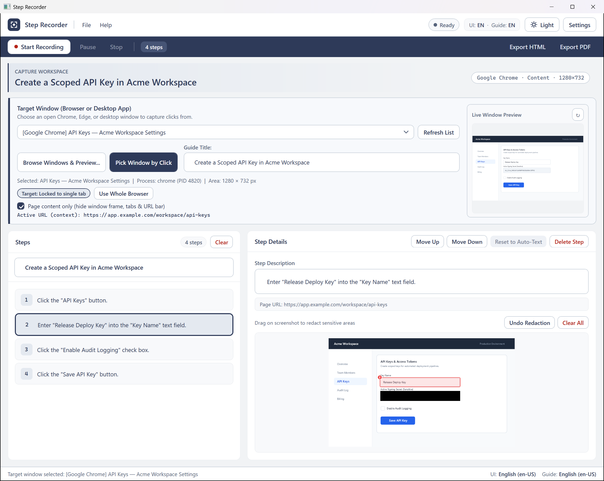
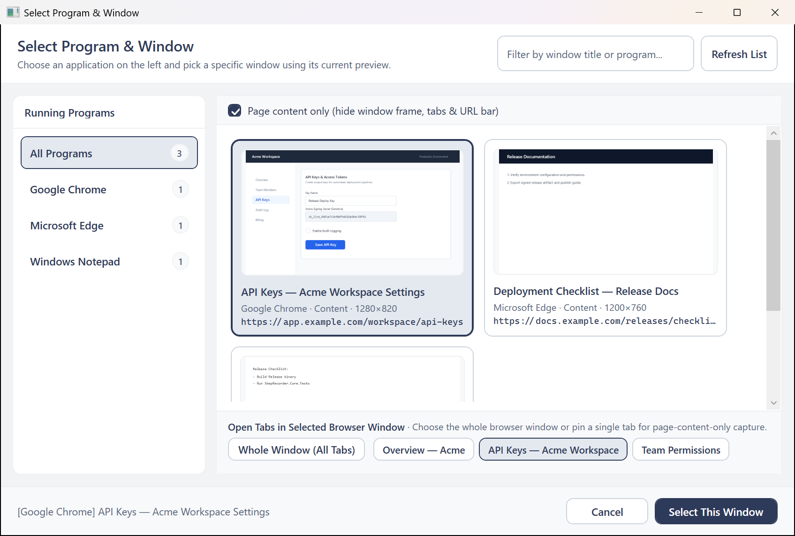
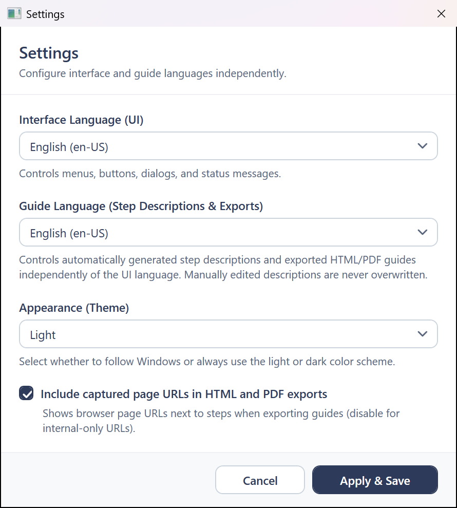
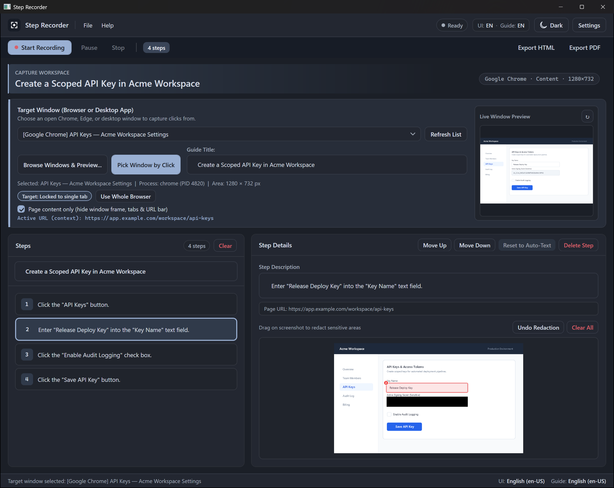

[English](README.md) | **Deutsch**

# Step Recorder

[](#systemvoraussetzungen)
[-512BD4?style=flat-square)](#systemvoraussetzungen)
[](#datenschutz--lokale-speicherung)
[](LICENSE)

Ein schlanker, datenschutzfreundlicher Ersatz für die Windows-Schrittaufzeichnung (`psr.exe`) unter **Windows 10 / 11** zur lokalen Dokumentation von Browser-Workflows und Desktop-Anwendungen — komplett ohne Cloud, Benutzerkonten oder Telemetrie.



---

## Schnellstart

1. **Voraussetzung:** Die [.NET 10 Desktop Runtime](https://dotnet.microsoft.com/download/dotnet/10.0) für Windows muss installiert sein (bei installiertem .NET 10 SDK bereits enthalten).
2. **Download:** Repository herunterladen (**Code → Download ZIP** oder klonen) und entpacken.
3. **Starten:** Den Ordner `App` öffnen und **`StepRecorder.App.exe`** starten.

---

## Funktionen im Überblick

- **100 % lokal & offline:** Alle Bildschirmaufnahmen, UI-Analysen und Exporte laufen ausschließlich lokal auf Ihrem Rechner. Keine Netzwerkverbindungen, keine Konten, keine Telemetrie.
- **Gezielte Fenster- & Browser-Auswahl:**
  - Auswahl über Schnell-Dropdown, den visuellen **Fenster-Browser** (gruppiert nach Programmen mit Live-Vorschau, Suche und Wiederherstellung minimierter Fenster) oder per **Klick-Auswahl** (Abbruch mit `Esc` oder Rechtsklick).
  - **Browser-Unterstützung:** Erkennt Chromium-Browser (`chrome`, `msedge`, `brave`, `vivaldi`, `opera`, `arc`, `chromium`, `thorium`, `sidekick`) sowie Gecko-Browser (`firefox`, `librewolf`, `waterfox`, `floorp`, `zen`).
  - **Nur Seiteninhalt & Tab-Fixierung:** Browser-Screenshots lassen sich optional auf den reinen Webseiten-Viewport zuschneiden (ohne Tabs/Adressleiste) oder fest auf einen einzelnen Tab pinnen (wechseln Sie den Tab, pausiert die Erfassung automatisch mit Warnhinweis).
- **Intelligente Eingabe-Erkennung & automatische Schritttexte:**
  - Erfasst Linksklicks, Doppelklicks (automatisch zusammengeführt innerhalb der Windows-Doppelklickzeit und 6 px Radius), Rechtsklicks sowie zusammengefasste Texteingaben (900 ms Debounce; Abschluss per `Enter`, `Tab`, `Escape` oder Klick/Fokuswechsel; unterstützt `AltGr`-Zeichen und ignoriert Steuerungs-Hotkeys).
  - Klicks in bearbeitbare Felder (`Edit` / `ComboBox`) mit anschließender Eingabe werden sauber zum Texteingabe-Schritt aufgewertet, statt doppelte Schritte zu erzeugen.
  - **Passwortschutz:** Bei Passwortfeldern (`IsPassword`) werden weder eingegebene Zeichen noch sensible Feldbezeichnungen in die Schrittbeschreibung übernommen.
- **Integrierter Screenshot-, Markierungs- & Zuschnitt-Editor:**
  - **Automatische Markierungen & Raw-Neunummerierung:** Jeder aufgenommene Screenshot erhält automatisch Hervorhebungsrahmen um das bediente Element, Klick-Marker und Schritt-Badges. Zusätzlich bleibt eine unannotierte Rohaufnahme erhalten, sodass Schritt-Badges beim Umsortieren, Löschen, Kombinieren oder Aufteilen sauber neu gerendert werden.
  - **6 Bearbeitungswerkzeuge & Farbauswahl:** Direkt im Editor stehen **Schwärzen** (schwarze Rechtecke), **Rahmen**, **Pfeil**, **Hinweis** (Textnotiz optional mit Hinweislinie), **Nummer** (fortlaufende Nummern-Spots `1, 2, 3` per Klick oder als nummerierter Rahmen) und nicht-destruktiver **Zuschnitt** zur Verfügung — inklusive 4 Markierungsfarben.
  - **Multi-Bereich-Zuschnitt (Collage):** Aktivieren Sie **`+ Bereich`** (oder halten Sie `Strg` beim Ziehen im Zuschnitt-Werkzeug), um mehrere getrennte Ausschnitte auf einem Screenshot zu markieren und beim Export kompakt als Collage zusammenzuführen.
  - **Rückgängig / Wiederholen (`Strg+Z` / `Strg+Y`):** Durchgängiger Verlauf pro Schritt sowie *Zuschnitt aufheben* und *Alle entfernen*; beim Export werden alle Bearbeitungen fest in die HTML- und PDF-Bilder eingebrannt.
- **Nachbearbeitung & Schritte kombinieren:**
  - Anleitungstitel anpassen, einzelne Schritttexte manuell bearbeiten (jederzeit auf den automatischen Text zurücksetzbar), Schritte umsortieren (hoch / runter), löschen (inkl. automatischer Neunummerierung der Badges) oder die gesamte Sitzung leeren.
  - **Schritte kombinieren & wieder aufteilen:** Markieren Sie mehrere Schritte in der Liste (`Strg` / `Umschalt`), um sie zu einem kompakten Schritt zusammenzufassen — wahlweise **auf einem Bild überlagert** (`a, b, c`-Markierungen für dieselbe Maske/dasselbe Formular) oder **als Collage nebeneinander** mit Ablaufpfeilen für verschiedene Fenster. Kombinierte Beschreibungen (`a) …`, `b) …`) reagieren dynamisch auf Sprachwechsel und lassen sich jederzeit wieder über **Aufteilen** in die Einzelschritte zerlegen.
- **Unabhängige UI- & Anleitungssprache (`de-DE` / `en-US`):**
  - Programmoberfläche und erzeugte Anleitungssprache sind unabhängig voneinander einstellbar. Ein Wechsel der Anleitungssprache übersetzt automatisch generierte Schritte sofort neu, während manuell bearbeitete Texte erhalten bleiben.
- **Einzeldatei-HTML- & mehrseitiger A4-PDF-Export:**
  - **HTML (`.html`):** Eigenständige Offline-HTML-Datei mit eingebetteten Base64-PNG-Screenshots, optionalen klickbaren Seiten-URLs (`http`/`https`, bei gleichen Folge-URLs dedupliziert) und interaktiver Lightbox-Vergrößerung.
  - **PDF (`.pdf`):** Mehrseitiges A4-Dokument mit Kopfzeile, nummerierten Schrittkarten, optionalen URLs und fest eingebrannten Screenshots.
  - Der Speichern-Dialog öffnet standardmäßig in `%USERPROFILE%\Downloads` (merkt sich den zuletzt gewählten Exportordner) und bietet direktes Öffnen nach dem Export an.
- **Moderne Windows-Oberfläche:** `PerMonitorV2`-DPI-Unterstützung, Design-Modi (`System`, `Hell`, `Dunkel` sowie Windows-Hochkontrast) und ein kompaktes **Aufnahme-HUD**, das während der Aufnahme im Vordergrund schwebt.

---

## Typischer Ablauf

1. **Zielfenster wählen** über Dropdown, den visuellen **Fenster-Browser** oder **Fenster per Klick wählen** (bei Browsern optional *Nur Seiteninhalt* oder einen einzelnen Tab fixieren).
2. **Aufnahme starten:** Das Hauptfenster minimiert sich und das schwebende **Aufnahme-HUD** zeigt Status, Schrittzähler, *Pause / Fortsetzen* und *Stopp*.
3. **Prüfen, annotieren & kombinieren:** Texte korrigieren, Schritte umsortieren, entfernen oder zusammenfassen (*Überlagerung* / *Collage*), vertrauliche Bildbereiche schwärzen, Rahmen/Pfeile/Hinweise/Nummern setzen oder Screenshots zuschneiden.
4. **Exportieren:** Anleitung als eigenständige **HTML-Datei** oder **A4-PDF** speichern.

---

## Screenshots

### Fenster- & Browser-Tab-Auswahl

Wähle komplette Fenster oder einzelne Browser-Tabs direkt über Live-Vorschauen aus — inklusive Option zur Erfassung von **nur Seiteninhalt**:



### Getrennte UI- & Anleitungs-Sprachen

Bedienoberfläche und exportierte Schritt-Texte lassen sich unabhängig voneinander einstellen, inklusive Theme-Wahl zwischen Hell und Dunkel:



### Dark Mode (Ergänzung)

Standardmäßig nutzt Step Recorder das helle Design; optional steht auch ein dunkles Design zur Verfügung:



---

## Systemvoraussetzungen

- **Betriebssystem:** Windows 10 oder Windows 11 (x64, x86 oder ARM64).
- **Laufzeitumgebung:** [.NET 10 Desktop Runtime](https://dotnet.microsoft.com/download/dotnet/10.0) (bei installiertem .NET 10 SDK bereits enthalten).

---

## Inhalt des Repositories

```text
Step Recorder/
├── App/                        # Direkt startbare Windows-Anwendung (StepRecorder.App.exe + Runtime-DLLs)
├── screenshots/                # UI-Screenshots für die README
├── README.md                   # Englische Projektdokumentation (GitHub-Standard)
├── README.de.md                # Deutsche Projektdokumentation
├── LICENSE                     # Rechtsverbindliche MIT-Lizenz (englisches Original)
└── LICENSE.de.md               # Deutsche Lizenz-Zusammenfassung & Drittanbieter-Hinweise
```

---

## Datenschutz & lokale Speicherung

- **Einstellungen:** Lokal als JSON unter `%LOCALAPPDATA%\StepRecorder\settings.json`.
- **Temporäre Screenshots:** Werden pro Sitzung lokal unter `%TEMP%\StepRecorder\Sessions\<sitzungs-id>\` abgelegt.
- **URL-Export steuerbar:** Das Einbeziehen von Seiten-URLs beim Export lässt sich jederzeit in den **Einstellungen** deaktivieren.
- **Passwortschutz:** Erkannte Passwortfelder (`IsPassword`) protokollieren weder Eingaben noch Feldnamen im Klartext.

---

## Verwendete Bibliotheken

| Bibliothek | Version | Zweck | Lizenz |
| :--- | :--- | :--- | :--- |
| [CommunityToolkit.Mvvm](https://github.com/CommunityToolkit/dotnet) | `8.4.2` | MVVM-Basisklassen & Commands | MIT |
| [FlaUI.UIA3](https://github.com/FlaUI/FlaUI) | `5.0.0` | Windows UI Automation (Steuerelemente, Browser-Tabs & URLs) | MIT |
| [Microsoft.Windows.CsWin32](https://github.com/microsoft/CsWin32) | `0.3.371` | Generierte Win32-P/Invoke-Bindungen | MIT |
| [Scriban](https://github.com/scriban/scriban) | `7.6.1` | Template-Rendering für den Single-File-HTML-Export | BSD-2-Clause |
| [SkiaSharp](https://github.com/mono/SkiaSharp) | `4.156.0` | Screenshot-Annotierung, Schwärzung & A4-PDF-Export | MIT |

---

## Lizenz

Copyright (c) 2026 **Marcel Prinz**.  
Veröffentlicht unter der **MIT-Lizenz** — siehe [`LICENSE`](LICENSE) für den verbindlichen englischen Originaltext sowie [`LICENSE.de.md`](LICENSE.de.md) für die deutsche Übersicht und Drittanbieter-Hinweise.
