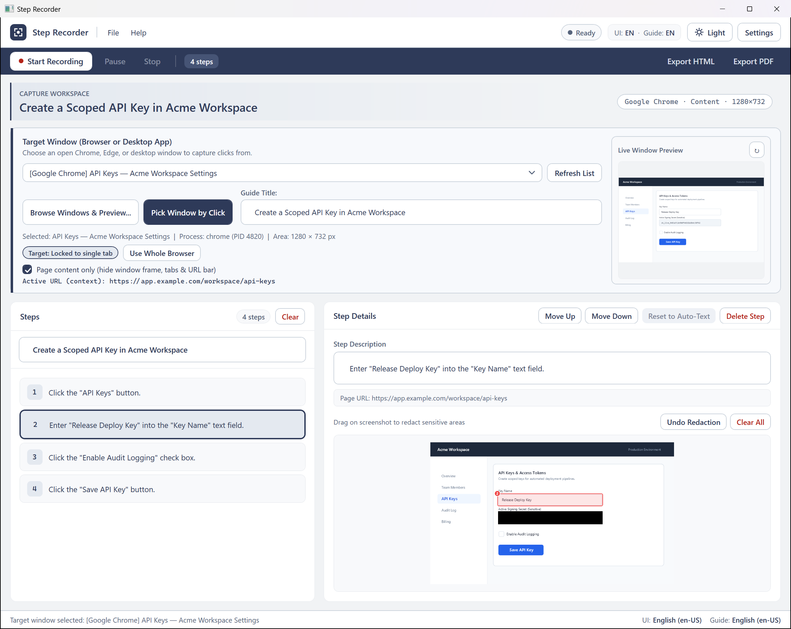
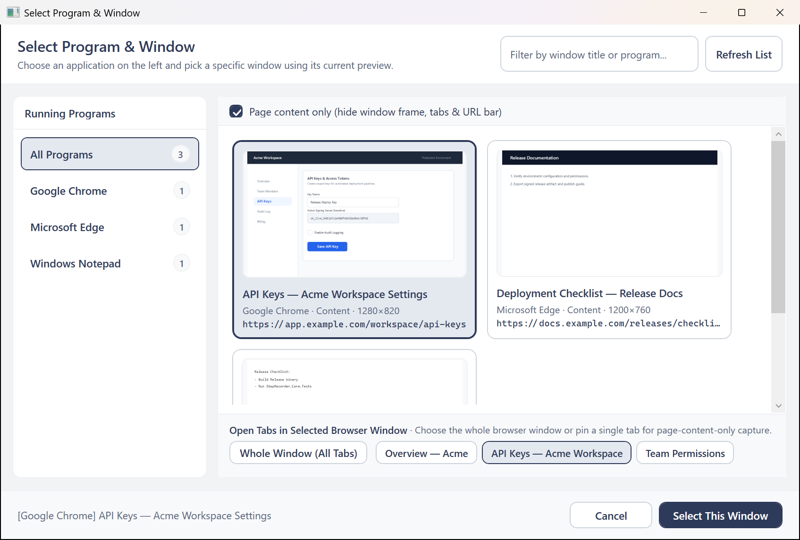
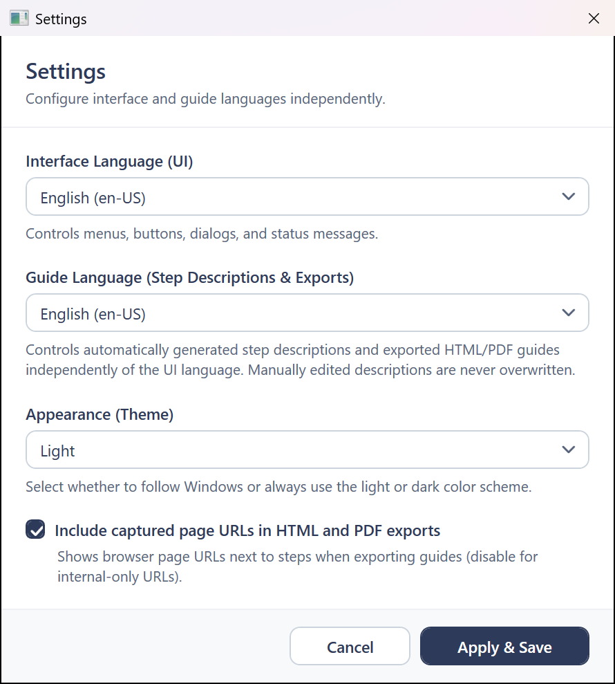
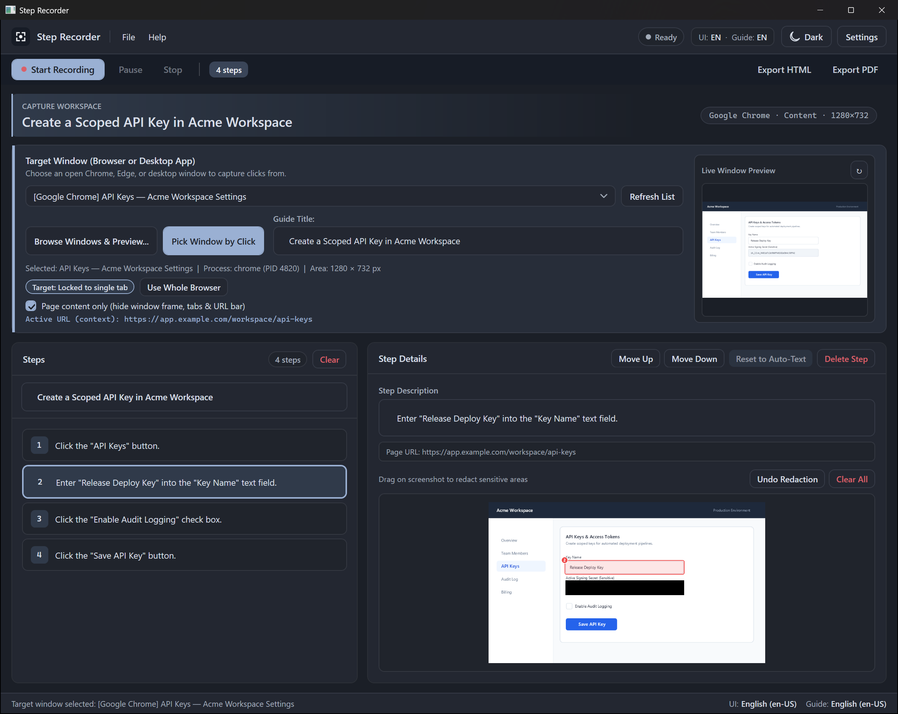

**English** | [Deutsch](README.de.md) · [Changelog](CHANGELOG.md)

# Step Recorder

[](#system-requirements)
[-512BD4?style=flat-square)](#system-requirements)
[](#privacy--local-storage)
[](LICENSE)

A lightweight, privacy-first **Windows 10 / 11** replacement for the legacy Windows Steps Recorder (`psr.exe`) for documenting browser workflows and desktop applications locally — without cloud accounts, background services, or telemetry.



---

## Quick Start

1. **Prerequisites:** Install the [.NET 10 Desktop Runtime](https://dotnet.microsoft.com/download/dotnet/10.0) for Windows (already included if you have the .NET 10 SDK installed).
2. **Download:** Download this repository (**Code → Download ZIP** or clone it) and extract it to any folder.
3. **Launch:** Open the `App` folder and double-click **`StepRecorder.App.exe`**.

---

## Key Features

- **100% Local & Offline:** All screen captures, UI inspections, and guide exports run purely on your machine. No network requests, accounts, or telemetry.
- **Flexible Window & Browser Targeting:**
  - Pick an application from the live dropdown, open the **Window Browser** (grouped by program with live preview thumbnails, search, and minimized-window restore), or use **Click-to-Pick** (`Esc` or right-click to cancel).
  - **Browser-Aware Capture:** Supports Chromium browsers (`chrome`, `msedge`, `brave`, `vivaldi`, `opera`, `arc`, `chromium`, `thorium`, `sidekick`) and Gecko browsers (`firefox`, `librewolf`, `waterfox`, `floorp`, `zen`).
  - **Page Content Only & Single-Tab Pinning:** Optionally crop browser screenshots strictly to the rendered webpage viewport (excluding tabs/address bar) or lock capture to a single browser tab (automatically pausing capture with a warning badge if you switch away).
- **Smart Input Capture & Automatic Step Text:**
  - Records left-clicks, double-clicks (merged cleanly within Windows double-click time and a 6 px radius), right-clicks, and debounced text-input bursts (900 ms debounce; flushes on `Enter`, `Tab`, `Escape`, or focus/click change; supports `AltGr` characters while ignoring shortcut hotkeys).
  - Automatically upgrades clicks inside editable controls (`Edit` / `ComboBox`) into text-input steps instead of producing duplicate steps.
  - **Password Field Protection:** Password controls (`IsPassword`) never log keystrokes or expose sensitive field labels in generated descriptions.
- **Built-In Screenshot Annotation, Redaction & Crop Editor:**
  - **Automatic Captures & Live Re-Badging:** Every captured screenshot is automatically annotated with element bounding highlights, click markers, and step badges while preserving raw captures so step badges cleanly re-render whenever steps are reordered, deleted, combined, or split.
  - **6 Editing Tools & Color Palette:** Switch between **Redact** (solid black rectangles), **Box** (highlight frames), **Arrow** (directional arrows), **Note** (callout text notes with optional pointer line), **Spot** (sequential numbered badges `1, 2, 3` as points or highlighted boxes), and non-destructive **Crop** — with 4 accent color swatches.
  - **Multi-Region Crop Cutout Collage:** Enable **`+ Region`** (or hold `Ctrl` while dragging in Crop mode) to select multiple areas on the same screenshot and stitch them into a clean cutout collage on export.
  - **Unified Undo / Redo:** Full `Ctrl+Z` / `Ctrl+Y` history per step plus one-click *Reset Crop* and *Clear All*; all edits are permanently flattened into exported HTML and PDF images.
- **Post-Recording Step Editor & Step Combining:**
  - Rename the guide title, edit individual step descriptions manually (with one-click reset back to auto-generated text), reorder steps (Up / Down), delete steps with automatic badge renumbering, or clear the session.
  - **Combine & Split Steps:** Multi-select steps in the step list (`Ctrl` / `Shift`) to combine them into a single compact step — either **Overlay on one screenshot** (`a, b, c` markers on the same form/window) or **Arrange as collage** side by side with flow arrows for separate screens. Combined steps format sub-steps as `a) …`, `b) …`, adapt dynamically on guide language switches, and can be **Split** back into individual steps at any time.
- **Independent UI & Guide Languages (`de-DE` / `en-US`):**
  - Switch the app interface language and the generated guide language independently at runtime. Changing the guide language dynamically regenerates unedited step descriptions while preserving manual edits.
- **Single-File HTML & Multi-Page A4 PDF Export:**
  - **HTML (`.html`):** Self-contained offline file with embedded Base64 PNG screenshots, optional deduplicated clickable page URLs (`http`/`https`), and an interactive click-to-zoom lightbox.
  - **PDF (`.pdf`):** Clean multi-page A4 guide with document header, numbered step cards, optional URLs, and flattened screenshots.
  - The save dialog opens in `%USERPROFILE%\Downloads` by default (remembering the last export folder) and offers to open the exported document immediately.
- **Adaptive Windows UI:** `PerMonitorV2` DPI awareness, `System` / `Light` / `Dark` / Windows High-Contrast theme support, and a compact always-on-top **Recording HUD** while the main window minimizes during capture.

---

## Workflow at a Glance

1. **Select a Target Window** via the dropdown, the visual **Window Browser**, or **Click-to-Pick** (for browsers, optionally enable *Page Content Only* or pin a single tab).
2. **Start Recording:** The main window minimizes cleanly and the floating **Recording HUD** shows live status, step count, *Pause / Resume*, and *Stop*.
3. **Review, Annotate & Combine:** Adjust step descriptions, reorder, remove, or combine related steps (*Overlay* or *Collage*), redact sensitive regions, add boxes/arrows/notes/numbered spots, or crop to key regions directly in the editor.
4. **Export:** Save as a self-contained **HTML** guide or an **A4 PDF**.

---

## Screenshots

### Target Window & Browser Tab Selection

Pick an entire window or pin an open browser tab and capture **page content only** with live window previews:



### Independent UI & Guide Languages

Keep the application UI in one language while generating exported step instructions in another, and switch between Light and Dark themes:



### Dark Mode (Supplementary Theme)

Step Recorder uses Light Mode by default and includes a built-in Dark Mode option:



---

## System Requirements

- **OS:** Windows 10 or Windows 11 (x64, x86, or ARM64).
- **Runtime:** [.NET 10 Desktop Runtime](https://dotnet.microsoft.com/download/dotnet/10.0) (included with the .NET 10 SDK).

---

## Repository Contents

```text
Step Recorder/
├── App/                        # Ready-to-run Windows application (StepRecorder.App.exe + runtime DLLs)
├── screenshots/                # UI screenshots used in the README
├── README.md                   # English documentation (default on GitHub)
├── README.de.md                # German documentation
├── CHANGELOG.md                # Version & change history (English)
├── CHANGELOG.de.md             # Version & change history (German)
├── LICENSE                     # Binding MIT License (English original)
└── LICENSE.de.md               # German license overview & third-party notices
```

---

## Privacy & Local Storage

- **Settings:** Stored locally as JSON at `%LOCALAPPDATA%\StepRecorder\settings.json`.
- **Temporary Screenshots:** Captured per session in `%TEMP%\StepRecorder\Sessions\<session-id>\`.
- **URL Export Control:** Page URL capture in exports can be disabled anytime in **Settings**.
- **Sensitive Input:** UIA password fields (`IsPassword`) suppress both typed characters and element names in generated step descriptions.

---

## Built With

| Library | Version | Purpose | License |
| :--- | :--- | :--- | :--- |
| [CommunityToolkit.Mvvm](https://github.com/CommunityToolkit/dotnet) | `8.4.2` | MVVM infrastructure & commands | MIT |
| [FlaUI.UIA3](https://github.com/FlaUI/FlaUI) | `5.0.0` | Windows UI Automation inspection (controls & browser tabs/URLs) | MIT |
| [Microsoft.Windows.CsWin32](https://github.com/microsoft/CsWin32) | `0.3.371` | Win32 P/Invoke interop bindings | MIT |
| [Scriban](https://github.com/scriban/scriban) | `7.6.1` | Self-contained HTML export template rendering | BSD-2-Clause |
| [SkiaSharp](https://github.com/mono/SkiaSharp) | `4.156.0` | Screenshot annotation, redaction flattening & A4 PDF rendering | MIT |

---

## License

Copyright (c) 2026 **Marcel Prinz**.  
Licensed under the **MIT License** — see [`LICENSE`](LICENSE) for the legally binding English text, or [`LICENSE.de.md`](LICENSE.de.md) for a German overview and third-party notices.
